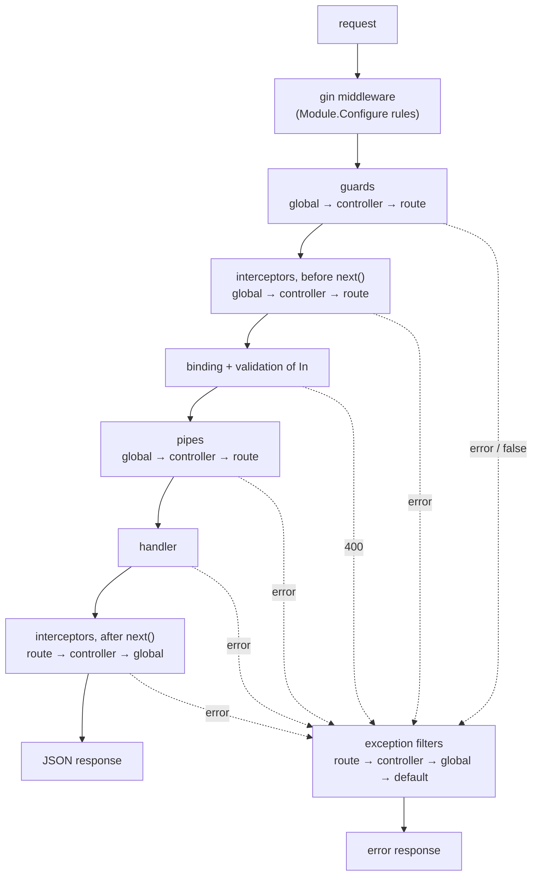

# The request pipeline

## Order

Gonest runs the same stages as NestJS, in the same order:



The same in plain text:

```text
gin middleware (Configure rules, module order)
  -> guards            global -> controller -> route      (false => 403, error => filters)
  -> interceptors      global -> controller -> route      (code before next())
       -> bind + validate In                               (failure => 400)
       -> pipes        global -> controller -> route
       -> handler
  <- interceptors      route -> controller -> global      (code after next())
  -> response (JSON, or 204 for NoContent)
errors anywhere -> filters: route -> controller -> global -> default filter
```

This is not just documentation: `examples/guide/pipeline_test.go` registers
a guard, interceptor, pipe and filter at every level plus a middleware, and
checks the trace. A request whose handler fails prints:

```text
418 {"statusCode":418,"message":"boom","error":"I'm a teapot"}
middleware
guard global
guard controller
guard route
interceptor global before
interceptor controller before
interceptor route before
pipe global
pipe controller
pipe route
handler
interceptor route after
interceptor controller after
interceptor global after
filter route (handled=false)
filter controller (handled=false)
filter global (handled=true)
```

Where things are attached:

| Level | How |
|---|---|
| global | providers `gonest.AppGuard(ctor)`, `AppInterceptor`, `AppPipe`, `AppFilter` (built by the container, so injected), or options `gonest.WithGlobalGuards(...)` etc. on `gonest.New` (options first) |
| controller | `r.Use(gonest.UseGuards(...), gonest.UseInterceptors(...), ...)` in `Routes` |
| route | the same options passed to `r.GET(path, handler, opts...)` |

Enhancers are values. Controller and route enhancers are usually injected
into the controller and passed to `UseGuards`, as the SaaS projects
controller does with `JWTGuard` and `RolesGuard`.

Everything is composed at startup into one closure per route; a request does
not look up enhancers.

## Guards

```text
type Guard interface { CanActivate(ctx *gonest.Ctx) (bool, error) }
```

Return `true` to continue, `false` for 403 `Forbidden resource`, or an error
(usually `gonest.Unauthorized(...)`) for the filters to render.
`gonest.GuardFunc` adapts a function.

<!-- snippet: examples/saas/internal/auth/guards.go#jwt-guard -->
```go
// JWTGuard authenticates "Authorization: Bearer <jwt>" requests and stores
// the user in the request values (see CurrentUser).
type JWTGuard struct {
	tokens *TokenService
}

// NewJWTGuard is the provider constructor; TokenService is injected.
func NewJWTGuard(tokens *TokenService) *JWTGuard { return &JWTGuard{tokens: tokens} }

// CanActivate implements gonest.Guard. Returning an *HTTPError gives a 401;
// returning false would give the default 403.
func (g *JWTGuard) CanActivate(ctx *gonest.Ctx) (bool, error) {
	raw, ok := strings.CutPrefix(ctx.Header("Authorization"), "Bearer ")
	if !ok || raw == "" {
		return false, gonest.Unauthorized("missing bearer token")
	}
	claims, err := g.tokens.Verify(raw)
	if err != nil {
		msg := "invalid token"
		if errors.Is(err, ErrExpiredToken) {
			msg = "token expired"
		}
		return false, gonest.Unauthorized(msg).Wrap(err)
	}
	ctx.Set(UserKey, &User{ID: claims.Subject, Email: claims.Email, TenantID: claims.TenantID, Roles: claims.Roles})
	return true, nil
}
```

### Metadata and roles

`gonest.SetMetadata(key, value)` attaches data to a route or, through
`r.Use`, to a controller; guards read it with `ctx.Route().Metadata(key)`
(route first, then controller). This replaces NestJS custom decorators plus
`Reflector`:

<!-- snippet: examples/saas/internal/auth/guards.go#roles -->
```go
// Roles requires the authenticated user to have at least one of roles
// (NestJS @Roles() built on SetMetadata). Use it on a route or, through
// Router.Use, on a whole controller, together with RolesGuard.
func Roles(roles ...string) gonest.RouteOption {
	return gonest.SetMetadata(rolesKey, roles)
}

// RolesGuard enforces Roles metadata. Routes without metadata are allowed.
// It must run after JWTGuard.
type RolesGuard struct{}

// NewRolesGuard is the provider constructor.
func NewRolesGuard() *RolesGuard { return &RolesGuard{} }

// CanActivate implements gonest.Guard. Route metadata wins over controller
// metadata (Ctx.Route().Metadata looks at the route first).
func (RolesGuard) CanActivate(ctx *gonest.Ctx) (bool, error) {
	v, ok := ctx.Route().Metadata(rolesKey)
	if !ok {
		return true, nil
	}
	user, ok := CurrentUser(ctx)
	if !ok {
		return false, gonest.Unauthorized("not authenticated")
	}
	for _, r := range v.([]string) {
		if user.HasRole(r) {
			return true, nil
		}
	}
	return false, nil // 403 Forbidden resource
}
```

Used as `r.DELETE("/:id", gonest.Handle(c.Delete), auth.Roles(auth.RoleAdmin))`.

### Global guard with a public escape hatch

The common NestJS pattern of a global `AuthGuard` plus `@Public()`:

<!-- snippet: examples/guide/pipeline_test.go#public-metadata -->
```go
// isPublic is the metadata key of Public.
const isPublic = "public"

// Public marks a route that the global AuthGuard lets through
// (NestJS @Public() + Reflector).
func Public() gonest.RouteOption { return gonest.SetMetadata(isPublic, true) }

// AuthGuard is registered with gonest.AppGuard, so it runs for every route.
type AuthGuard struct{}

// CanActivate implements gonest.Guard.
func (AuthGuard) CanActivate(ctx *gonest.Ctx) (bool, error) {
	if v, ok := ctx.Route().Metadata(isPublic); ok && v == true {
		return true, nil
	}
	if ctx.Header("Authorization") == "" {
		return false, gonest.Unauthorized("login required")
	}
	return true, nil
}
```

<!-- snippet: examples/guide/pipeline_test.go#app-guard -->
```go
mod := &gonest.Module{
	Name:        "app",
	Providers:   []gonest.Provider{gonest.AppGuard(func() AuthGuard { return AuthGuard{} })},
	Controllers: []any{func() StatusController { return StatusController{} }},
}
```

```text
GET /status                      -> 200 "up"
GET /admin                       -> 401 {"statusCode":401,"message":"login required","error":"Unauthorized"}
GET /admin (with Authorization)  -> 200 "secret"
```

Note: global guards are not visible in the route metadata, so the OpenAPI
document does not add 401/403 responses or security requirements for them.
Prefer controller-level guards plus `gonest.Security(...)` when the document
matters, as the SaaS example does.

## Interceptors

```text
type Interceptor interface { Intercept(ctx *gonest.Ctx, next gonest.Next) (any, error) }
```

Code before `next()` runs before binding and the handler; code after it sees
(and may replace) the result or the error. The response is written after the
outermost interceptor returns, so interceptors may still set headers.

<!-- snippet: examples/saas/internal/platform/platform.go#timing-interceptor -->
```go
// TimingHeader is set on every response produced through the pipeline.
const TimingHeader = "X-Response-Time"

// TimingInterceptor measures the time spent in the rest of the pipeline
// (inner interceptors, binding, pipes and the handler). Registered with
// gonest.AppInterceptor, it is a global interceptor built by the container,
// so its own dependencies are injected.
type TimingInterceptor struct {
	slowAfter time.Duration
}

// NewTimingInterceptor is the provider constructor. The logger parameter is
// not needed at construction; it shows that enhancers are ordinary providers.
func NewTimingInterceptor(l *slog.Logger) *TimingInterceptor {
	l.Debug("timing interceptor ready")
	return &TimingInterceptor{slowAfter: 250 * time.Millisecond}
}

// Intercept implements gonest.Interceptor. The code after next() runs before
// the response is written, so the header still reaches the client, also when
// next returns an error that an exception filter renders.
func (t *TimingInterceptor) Intercept(ctx *gonest.Ctx, next gonest.Next) (any, error) {
	start := time.Now()
	out, err := next()
	d := time.Since(start)
	ctx.Writer().Header().Set(TimingHeader, d.String())
	if d > t.slowAfter {
		// logger.FromCtx returns the request logger (with request_id) set by
		// logger.RequestLogger, or Ctx.Logger() when that middleware is absent.
		logger.FromCtx(ctx).Warn("slow handler", "route", ctx.Route().Path, "duration", d)
	}
	return out, err
}
```

Registered as a global interceptor with
`gonest.AppInterceptor(NewTimingInterceptor)`. Calling `next()` twice
re-runs pipes and the handler (binding is done once per request).

## Pipes

```text
type Pipe interface { Transform(ctx *gonest.Ctx, v any, meta gonest.ArgMeta) (any, error) }
```

Built-in binding and validation run first (Gonest's `ValidationPipe` is
always on); pipes then receive the bound `In` value and must return a value
of exactly the same type (`meta.Type`), or an error.

<!-- snippet: examples/saas/internal/projects/controller.go#pipe -->
```go
// TrimPipe trims the name and description of a CreateInput. Pipes run after
// binding and validation and must return a value of the same type
// (meta.Type), or an error.
var TrimPipe = gonest.PipeFunc(func(_ *gonest.Ctx, v any, _ gonest.ArgMeta) (any, error) {
	in, ok := v.(CreateInput)
	if !ok {
		return v, nil
	}
	in.Name = strings.TrimSpace(in.Name)
	in.Description = strings.TrimSpace(in.Description)
	if len(in.Name) < 3 {
		return nil, gonest.BadRequest("name must have at least 3 non-blank characters")
	}
	return in, nil
})
```

## Exception filters

```text
type ExceptionFilter interface { Catch(ctx *gonest.Ctx, err error) bool }
```

`Catch` writes a response and returns `true`, or returns `false` to let the
next filter try. Filters are tried route, controller, global; the default
filter renders `*gonest.HTTPError` (and `gonest.ValidationErrors`) and turns
everything else into 500.

<!-- snippet: examples/saas/internal/projects/errors.go#domain-filter -->
```go
// DomainError is a business rule violation. Services return it without
// knowing about HTTP; DomainErrorFilter turns it into a 422 response.
type DomainError struct {
	Code    string
	Message string
}

// Error implements error.
func (e *DomainError) Error() string { return e.Code + ": " + e.Message }

// DomainErrorFilter is an exception filter (NestJS @Catch(DomainError)).
// It handles *DomainError anywhere in the error chain and lets every other
// error fall through to the next filter (and finally the default one).
var DomainErrorFilter = gonest.ExceptionFilterFunc(func(ctx *gonest.Ctx, err error) bool {
	var de *DomainError
	if !errors.As(err, &de) {
		return false
	}
	body := gonest.UnprocessableEntity(de.Message, map[string]string{"code": de.Code}).Body()
	ctx.Gin().JSON(http.StatusUnprocessableEntity, body)
	return true
})
```

The service returns `&DomainError{Code: "quota_exceeded", ...}`; the
client receives

```json
{"statusCode":422,"message":"plan \"starter\" allows 5 projects","error":"Unprocessable Entity","details":{"code":"quota_exceeded"}}
```

## Middleware

Gin middleware is bound with `Module.Configure` (see
[Modules](modules.md#middleware-configure)). It runs before guards, so the
SaaS tenant middleware answers 400 for a missing `X-Tenant-ID` header even
when the token is missing too. Use `c.AbortWithStatusJSON(...)` with
`gonest.X(...).Body()` to keep the error shape consistent.
